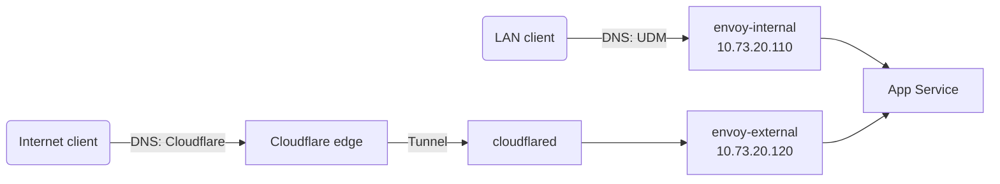

# Networking

## Addressing

| Address | What |
| --- | --- |
| `10.73.0.254` | UDM Pro Max (gateway, BGP router ID) |
| `10.73.1.10` | NAS (`nas.internal`): TrueNAS UI, NFS, BGP peer address and router ID |
| `10.73.2.100` | Traefik reverse proxy on the NAS (`docker.bykaj.app`), announced over BGP as a `/32`; primary address, so the NAS's outbound traffic uses it as source |
| `10.73.20.0/24` | Servers subnet: node IPs and the Cilium LoadBalancer pool |

The servers subnet is divided into fixed ranges:

| Range | Use |
| --- | --- |
| `10.73.20.10`–`.90` | Nodes |
| `10.73.20.100` | `kube-api` LoadBalancer |
| `10.73.20.110`–`.190` | Gateways |
| `10.73.20.200`–`.250` | LoadBalancer IPs for services |

Assigned addresses in the servers subnet:

| Address | What |
| --- | --- |
| `10.73.20.10` / `.20` / `.30` | `k8s-01` / `k8s-02` / `k8s-03` |
| `10.73.20.100` | `kube-api` LoadBalancer (`k8s.internal`) |
| `10.73.20.110` | `envoy-internal` Gateway (`internal.bykaj.app`) |
| `10.73.20.120` | `envoy-external` Gateway (`external.bykaj.app`) |
| `10.73.20.200` | Plex LoadBalancer |
| `10.73.20.201` | Jellyfin LoadBalancer |
| `10.73.20.202` | EMQX MQTT listeners (`mqtt.bykaj.io`) |
| `10.73.20.203` | `smtp-relay` LoadBalancer (`smtp.bykaj.io`) |

## Cilium

[Cilium](https://cilium.io) runs in native routing mode with full kube-proxy
replacement, DSR load balancing and BBR bandwidth management on the `bond+`
devices. LoadBalancer Service IPs come from a `CiliumLoadBalancerIPPool`
covering `10.73.20.0/24` and are announced to the UDM over BGP. See
[BGP & Load Balancing](bgp.md).

Service topology (`loadBalancer.serviceTopology`) is enabled, so Cilium honours
`trafficDistribution` and topology hints on Services, including node-level
`PreferSameNode` (Cilium 1.20 or newer). Spegel's registry Service relies on
`PreferSameNode` to serve image pulls from the Spegel instance on the same node.

Two `CiliumCIDRGroup`s are available to network policies: `internet` (public
IPv4 space only, excluding private, CGNAT, loopback, link-local, multicast and
other special-purpose ranges) and `nas` (`10.73.1.10/32` and `10.73.2.100/32`,
both addresses on the NAS interface).

Network policies are not the default, but every app reachable through
`envoy-external` has an egress policy, as do some internal pods that hold
secrets or data. A new public app needs one too. Two exceptions:

- Gatus has none on purpose: it checks internal endpoints all over the
  cluster and LAN, so an allowlist would have to follow every check.
- `doco-cd-webhook` has no pod: it's an Envoy Gateway `Backend` that forwards
  two paths to doco-cd on the NAS.

Each policy file explains its own rules:

- [`audiobookshelf-egress`](https://github.com/bykaj/home-ops/blob/main/kubernetes/apps/media/audiobookshelf/app/networkpolicy.yaml)
  limits Audiobookshelf to Pocket ID, the SMTP relay and its metadata and
  cover providers by FQDN (see
  [Audiobookshelf](../../platforms/kubernetes/app-notes.md#audiobookshelf)).
- [`hermes-egress`](https://github.com/bykaj/home-ops/blob/main/kubernetes/apps/ai/hermes/app/networkpolicy.yaml)
  limits Hermes, an agent with a shell and two LiteLLM keys (one of them with
  Flux write access), to LiteLLM and Pocket ID: it has no internet egress, and
  searches the web through the Kagi MCP server (see
  [Hermes](../../platforms/kubernetes/app-notes.md#hermes)).
- `immich-egress`, `immich-microservices-egress` and
  `immich-machine-learning-egress` (one
  [`networkpolicy.yaml`](https://github.com/bykaj/home-ops/tree/main/kubernetes/apps/media/immich)
  per pod) limit the API and the workers to the database, cache, machine
  learning and the SMTP relay, plus Pocket ID (API), and machine learning to
  Hugging Face (see
  [Immich](../../platforms/kubernetes/app-notes.md#immich)).
- `it-tools-egress`, `wastebin-egress`, `echo-server-egress` and
  `kromgo-egress` (a `networkpolicy.yaml` in each app) give these public apps
  no egress besides DNS; kromgo may also query Prometheus for its badges.
- [`karakeep-egress` and `karakeep-chrome-egress`](https://github.com/bykaj/home-ops/blob/main/kubernetes/apps/default/karakeep/app/networkpolicy.yaml)
  allow Karakeep and its Chrome the internet through the `internet`
  `CiliumCIDRGroup` (public space only: no private, CGNAT, link-local or other
  special-purpose ranges, so not Talos's host DNS on 169.254.116.108 either),
  since they fetch whatever is bookmarked, but nothing in the cluster or on the
  LAN besides the app's own services (see
  [Karakeep](../../platforms/kubernetes/app-notes.md#karakeep)).
- [`konflate-egress`](https://github.com/bykaj/home-ops/blob/main/kubernetes/apps/flux-system/konflate/app/networkpolicy.yaml)
  limits konflate, which holds the GitHub App key for PR checks and comments,
  to the `internet` group on port 443: GitHub, the chart and image registries
  and the signature checks.
- [`litellm-egress`](https://github.com/bykaj/home-ops/blob/main/kubernetes/apps/ai/litellm/app/networkpolicy.yaml)
  limits the LiteLLM proxy, which holds the model provider keys, to an egress
  allowlist. Model providers and external MCP servers (such as Context7) are
  allowed by FQDN (`toFQDNs`), so a provider or MCP server on a new host needs
  a rule there. LiteLLM's own fetches (release check, cost map, blog posts)
  are off, so nothing else is allowed (see the
  [LiteLLM compromise](../../operations/history/2026-10-litellm-compromise.md#what-to-watch)).
- [`notification-controller-egress`](https://github.com/bykaj/home-ops/blob/main/kubernetes/apps/flux-system/flux-instance/app/networkpolicy.yaml)
  limits Flux's notification controller, which serves the public webhook
  receiver, to the Kubernetes API, Alertmanager and `api.github.com` (commit
  statuses). A Provider of another type needs a rule. `flux-instance` has
  `prune: false`, so a removed policy has to be deleted by hand.
- [`paperless-egress`](https://github.com/bykaj/home-ops/blob/main/kubernetes/apps/default/paperless/app/networkpolicy.yaml)
  limits Paperless, which holds every document and its LiteLLM key, to its
  database, cache, LiteLLM, Pocket ID and the SMTP relay, plus the FQDN
  `imap.fastmail.com` (port 993, for mail rules). Its Dutch OCR model comes
  from an image volume instead of an apt install, so it needs no Debian
  mirror (see
  [Paperless](../../platforms/kubernetes/app-notes.md#paperless)).
- [`plex-egress`](https://github.com/bykaj/home-ops/blob/main/kubernetes/apps/media/plex/app/networkpolicy.yaml)
  allows Plex the `internet` group on any port, since its plex.tv hosts change
  without notice, but nothing in the cluster or on the LAN (see
  [Plex](../../platforms/kubernetes/app-notes.md#plex)).
- [`pocket-id-egress`](https://github.com/bykaj/home-ops/blob/main/kubernetes/apps/security/pocket-id/app/networkpolicy.yaml)
  limits Pocket ID, which signs every app's tokens, to the SMTP relay,
  `download.maxmind.com` with the Cloudflare R2 host it redirects downloads to,
  and `raw.githubusercontent.com` (see
  [Pocket ID](../../platforms/kubernetes/app-notes.md#pocket-id)).
- [`seafile-*-egress`](https://github.com/bykaj/home-ops/blob/main/kubernetes/apps/default/seafile/app/networkpolicy.yaml)
  give every Seafile pod its own egress allowlist, since they hold the
  libraries or the S3, database and OAuth credentials. Seahub may reach its
  extensions, database, cache, LiteLLM, Garage (the `nas` group on port 443),
  Pocket ID and the SMTP relay; the extensions get a subset of that. None has
  internet egress (see
  [Seafile](../../platforms/kubernetes/app-notes.md#egress-policy)).
- [`smtp-relay`](https://github.com/bykaj/home-ops/blob/main/kubernetes/apps/network/smtp-relay/app/networkpolicy.yaml)
  limits who can send mail through the relay (see [SMTP relay](#smtp-relay)).
- [`windshift-egress`](https://github.com/bykaj/home-ops/blob/main/kubernetes/apps/default/windshift/app/networkpolicy.yaml)
  limits Windshift to its database, LiteLLM, Garage, Pocket ID, the SMTP relay
  and GitHub (its SCM integration) (see
  [Windshift](../../platforms/kubernetes/app-notes.md#windshift)).
- The [`database/dragonfly` component](../../platforms/kubernetes/components.md#databasedragonfly) limits
  ingress to each Dragonfly cache.

Any blocked egress packet raises the
[`CiliumEgressPolicyDenied`](../../operations/alerting/index.md#cluster-wide-additionalprometheusrulesmap)
alert (critical), per pod and destination. Only egress-restricted pods can cause
egress policy drops, so the alert means such a pod tried to reach a host outside
its allowlist: either a missing rule or something it should not be doing. The
one exception is an explicit `egressDeny`: Cilium reports those drops as
`POLICY_DENY` instead of `POLICY_DENIED`, and the alert deliberately ignores
them. Use it only for known, harmless traffic that is blocked anyway:
`karakeep-chrome-egress` denies multicast (`224.0.0.0/4`) for Chrome's local
discovery (see [Karakeep](../../platforms/kubernetes/app-notes.md#karakeep)),
and `plex-egress` denies multicast and broadcast (`255.255.255.255`) for
Plex's SSDP and GDM discovery (see
[Plex](../../platforms/kubernetes/app-notes.md#plex)). The
alert uses Hubble's `hubble_drop_total` metric, which names the source workload
and the destination (DNS name when Cilium knows it, IP otherwise). Hubble runs
on each agent for that metric; relay and UI are off. For the dropped flows
themselves, run `hubble observe --verdict DROPPED` (or
`cilium-dbg monitor --type drop`) in the cilium-agent on that node. Ingress drops
are not alerted on, because the Dragonfly and SMTP relay policies drop some
ingress traffic as normal.

CoreDNS runs without `autopath`, because it stops `toFQDNs` rules from
matching; see [KB-006](../../operations/troubleshooting/kb/006-tofqdns-timeouts.md).

## Gateways

Apps are exposed through the Gateway API, implemented by
[Envoy Gateway](https://gateway.envoyproxy.io). There are two Gateways, both
serving HTTP/3:

| Gateway | Hostname | Reached from |
| --- | --- | --- |
| `envoy-internal` | `internal.bykaj.app` | Home network only |
| `envoy-external` | `external.bykaj.app` | The internet, via the Cloudflare Tunnel |

An app picks its exposure by setting `parentRefs` on its `HTTPRoute` (the
`route` block in an app-template HelmRelease). Wildcard certificates for every
domain served (`bykaj.app`, `bykaj.dev`, `bykaj.io`, and others) are issued by
cert-manager and attached to both Gateways.

## SMTP relay

`smtp-relay` ([maddy](https://maddy.email)) accepts mail on port 25 without
authentication or TLS and forwards it to Fastmail on port 587, using the
credentials from the 1Password `smtp` item. Apps and the NAS all use
`smtp.bykaj.io:25` (`10.73.20.203`) without credentials, TLS or STARTTLS; only
the sender address still comes from the `smtp` item. Inside the cluster the name
resolves through the UDM like any other, which adds no dependency: the relay
needs the UDM to reach Fastmail anyway. maddy queues messages and retries when
Fastmail is unreachable; the queue is an `emptyDir`, so undelivered mail is lost
when a pod restarts.

Because anyone who can connect can send mail as the Fastmail
account, a `CiliumNetworkPolicy` allows the whole cluster but only the `nas`
`CiliumCIDRGroup` from the LAN. The Service uses `externalTrafficPolicy: Local`
so the NAS's source IP survives for the policy to match. `10.73.2.100` is the
primary address on the NAS interface, so mail from TrueNAS and from the Docker
stacks (masqueraded behind the host) arrives from it. To allow another LAN
host, add its CIDR to the policy.

Every `From` address an app uses must be an allowed alias or sending identity
in Fastmail. Rejections show up in the relay's logs, not in the app.

## Remote access

The [Tailscale operator](https://tailscale.com/kb/1236/kubernetes-operator)
runs one `Connector` in the `network` namespace: `homelab-egress`, an exit node.

Nothing in the cluster is published on the tailnet. There are no Tailscale
ingresses (`className: tailscale`) and no routes to the Service network
(`10.43.0.0/16`): both go straight to an app's Service and skip Envoy,
including the [Pocket ID login](../../platforms/kubernetes/components.md#gateway-oidc).

## Pages in this section

- [BGP & Load Balancing](bgp.md): UDM BGP peering, ECMP and flow hashing
- [DNS](dns.md): split-horizon DNS with two external-dns instances, plus HTTP/3 discovery
- [UDM Boot Scripts](udm-boot-scripts.md): persisting customizations across UDM firmware upgrades
