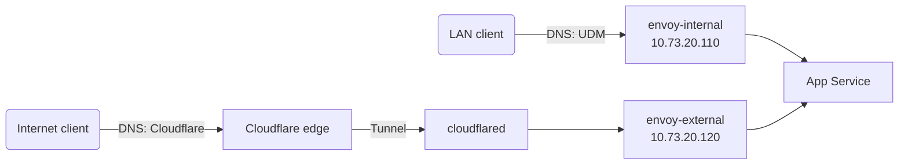

# Networking

## Addressing

| Address | What |
| --- | --- |
| `10.73.0.254` | UDM Pro Max (gateway, BGP router ID) |
| `10.73.1.10` | NAS, announced over BGP as a `/32` VIP |
| `10.73.2.100` | Traefik reverse proxy on the NAS (`docker.bykaj.app`) |
| `10.73.20.0/24` | Servers subnet: node IPs and the Cilium LoadBalancer pool |

The servers subnet is divided into fixed ranges:

| Range | Use |
| --- | --- |
| `10.73.20.10`–`.90` | Nodes |
| `10.73.20.100` | `kube-api` LoadBalancer |
| `10.73.20.110`–`.190` | Gateways |
| `10.73.20.200`–`.250` | LoadBalancer IPs for services |

Assigned addresses in the servers subnet:

| Address | What |
| --- | --- |
| `10.73.20.10` / `.20` / `.30` | `k8s-01` / `k8s-02` / `k8s-03` |
| `10.73.20.100` | `kube-api` LoadBalancer (`k8s.internal`) |
| `10.73.20.110` | `envoy-internal` Gateway (`internal.bykaj.app`) |
| `10.73.20.120` | `envoy-external` Gateway (`external.bykaj.app`) |
| `10.73.20.200` | Plex LoadBalancer |
| `10.73.20.201` | Jellyfin LoadBalancer |
| `10.73.20.202` | EMQX MQTT listeners (`mqtt.bykaj.io`) |
| `10.73.20.203` | `smtp-relay` LoadBalancer (`smtp.bykaj.io`) |

## Cilium

[Cilium](https://cilium.io) runs in native routing mode with full kube-proxy
replacement, DSR load balancing and BBR bandwidth management on the `bond+`
devices. LoadBalancer Service IPs come from a `CiliumLoadBalancerIPPool`
covering `10.73.20.0/24` and are announced to the UDM over BGP. See
[BGP & Load Balancing](bgp.md).

Service topology (`loadBalancer.serviceTopology`) is enabled, so Cilium honours
`trafficDistribution` and topology hints on Services, including node-level
`PreferSameNode` (Cilium 1.20 or newer). Spegel's registry Service relies on
`PreferSameNode` to serve image pulls from the Spegel instance on the same node.

Two `CiliumCIDRGroup`s are available to network policies: `internet` (all
public IPv4 space, excluding RFC 1918 ranges) and `nas` (`10.73.1.10/32` and
`10.73.2.100/32`, both addresses on the NAS interface).

## Gateways

Apps are exposed through the Gateway API, implemented by
[Envoy Gateway](https://gateway.envoyproxy.io). There are two Gateways, both
serving HTTP/3:

| Gateway | Hostname | Reached from |
| --- | --- | --- |
| `envoy-internal` | `internal.bykaj.app` | Home network only |
| `envoy-external` | `external.bykaj.app` | The internet, via the Cloudflare Tunnel |

An app picks its exposure by setting `parentRefs` on its `HTTPRoute` (the
`route` block in an app-template HelmRelease). Wildcard certificates for every
domain served (`bykaj.app`, `bykaj.dev`, `bykaj.io`, and others) are issued by
cert-manager and attached to both Gateways.

## SMTP relay

`smtp-relay` ([maddy](https://maddy.email)) accepts mail on port 25 without
authentication or TLS and forwards it to Fastmail on port 587, using the
credentials from the 1Password `smtp` item. Apps point at
`smtp-relay.network.svc.cluster.local:25` and need no credentials of their own.
maddy queues messages and retries when Fastmail is unreachable; the queue is an
`emptyDir`, so undelivered mail is lost when a pod restarts.

Outside the cluster it is reachable at `smtp.bykaj.io`
(`10.73.20.203`). Because anyone who can connect can send mail as the Fastmail
account, a `CiliumNetworkPolicy` allows the whole cluster but only the `nas`
`CiliumCIDRGroup` from the LAN. The Service uses `externalTrafficPolicy: Local`
so the NAS's source IP survives for the policy to match. `10.73.2.100` is the
primary address on the NAS interface, so mail from TrueNAS and from the Docker
stacks (masqueraded behind the host) arrives from it. To allow another LAN
host, add its CIDR to the policy.

Every `From` address an app uses must be an allowed alias or sending identity
in Fastmail. Rejections show up in the relay's logs, not in the app.

## Remote access

The [Tailscale operator](https://tailscale.com/kb/1236/kubernetes-operator)
runs one `Connector` in the `network` namespace: `homelab-egress`, an exit node.

Nothing in the cluster is published on the tailnet. There are no Tailscale
ingresses (`className: tailscale`) and no routes to the Service network
(`10.43.0.0/16`): both go straight to an app's Service and skip Envoy,
including the [Pocket ID login](../kubernetes/components.md#gateway-oidc).

## Pages in this section

- [BGP & Load Balancing](bgp.md): UDM BGP peering, ECMP and flow hashing
- [DNS](dns.md): split-horizon DNS with two external-dns instances, plus HTTP/3 discovery
- [UDM Boot Scripts](udm-boot-scripts.md): persisting customizations across UDM firmware upgrades
