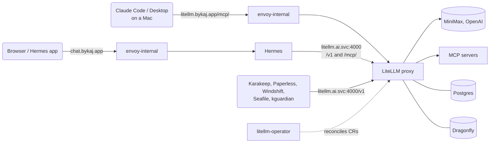

# AI

The cluster runs no models of its own. Everything AI goes through one
gateway, [LiteLLM](https://github.com/BerriAI/litellm) in the `ai` namespace,
which forwards model calls to hosted providers and MCP calls to a set of MCP
servers. Apps and workstations hold a scoped LiteLLM key, never a provider key.
Per-server details and gotchas are in [App Notes](app-notes.md#litellm).

## Overview



- **Apps in the cluster** call the proxy's Service directly
  (`http://litellm.ai.svc.cluster.local:4000/v1`, OpenAI-compatible).
- **Workstations** reach it at `https://litellm.bykaj.app`, which only has a
  route on `envoy-internal`. They use it for MCP only.
- **Admin UI** logins go through Pocket ID; the API and `/mcp/` take keys (see
  [App Notes](app-notes.md#litellm)).

Everything is declared as custom resources of the
[litellm-operator](https://github.com/home-operations/litellm-operator), which
runs from its own folder,
[`kubernetes/apps/ai/litellm-operator`](https://github.com/bykaj/home-ops/tree/main/kubernetes/apps/ai/litellm-operator)
(Flux Kustomization `litellm-operator`: the operator HelmRelease and its CRDs).
Apps that declare their own LiteLLM keys depend on it. The proxy is split over
two Flux Kustomizations in
[`kubernetes/apps/ai/litellm`](https://github.com/bykaj/home-ops/tree/main/kubernetes/apps/ai/litellm):

| Kustomization | Path | Contents |
| --- | --- | --- |
| `litellm` | `app/` | `LiteLLMProxy`, models, egress policy, ServiceMonitor, Postgres ([postgres](components.md#databasepostgres)), cache ([dragonfly](components.md#databasedragonfly)) and the ChatGPT token volume ([kopiur](components.md#kopiur)) |
| `litellm-mcp` | `mcp/` | MCP servers, the `claude-code` team and key, and the `hermes` and `ops` teams |

Postgres holds keys, teams, users and spend; Dragonfly is the response cache
and router state. Models and MCP servers are file-backed
(`store_model_in_db: false`): Git is the only source, and anything added in the
Admin UI is lost on the next reconcile.

## Models

Each model is a `LiteLLMModel` under `app/models/<provider>/`, named
`<provider>/<model>` in LiteLLM (the name clients and keys use). Provider API
keys come from the `litellm` 1Password item through `litellm-secret`; the
ChatGPT models sign in with a login instead (see below).

| Provider | Models | Notes |
| --- | --- | --- |
| ChatGPT | `gpt-6-astra`, `gpt-6-luna`, `gpt-6.1-sol` | The OpenAI row's GPT-6 models, billed to the ChatGPT Plus subscription instead of `OPENAI_API_KEY`; see [ChatGPT subscription](#chatgpt-subscription) |
| MiniMax | `MiniMax-M3`, `MiniMax-M3.1-Flash` | Each twice: plain names use MiniMax's OpenAI-compatible API (`/v1`, with `reasoning_split`), `-anthropic` names its Anthropic-compatible API (`/anthropic`) |
| OpenAI | GPT-6 Astra/Luna, GPT-6.1 Sol, `gpt-4.1-mini`, `gpt-4o-mini`, `text-embedding-3-small` | GPT-6 models use the Responses API and drop `temperature` |

The MiniMax models have prompt-cache injection points for the system prompt
and the last message; OpenAI caches prompts automatically.

Spend in the Admin UI comes from LiteLLM's bundled cost map (offline mode,
see [App Notes](app-notes.md#litellm)), which has no prices for the `anthropic/`
routes, `MiniMax-M3.1-Flash` or M3's price tier above 512K input tokens. The
MiniMax models therefore set MiniMax's official prices themselves
(`input_cost_per_token`, `output_cost_per_token`,
`cache_read_input_token_cost` and the `_above_512k_tokens` variants in
`params.additional`); update them when MiniMax changes its pricing. The
`chatgpt/` models log $0, because the subscription isn't billed per token.
Instead, the Plus fee ($20 a month from the 20th) is a subscription account
on the ChatGPT account, counted once per billing period. It's set in the Admin
UI and lives only in the database: neither the config nor the operator can
manage subscription accounts yet.

### ChatGPT subscription

The `chatgpt/` models use LiteLLM's
[ChatGPT provider](https://docs.litellm.ai/docs/providers/chatgpt), which
signs in to the ChatGPT Plus account through the Codex OAuth flow instead of
using an API key. Usage counts against the subscription's rolling and weekly
limits, not API billing. The provider calls `chatgpt.com` (Codex backend) and
`auth.openai.com` (token refresh), which `litellm-egress` allows. The Codex
backend adds its own system prompt to every request and ignores
`response_format` and output token limits, so structured output comes only
from the client's prompt.

The login lives in `auth.json` in `CHATGPT_TOKEN_DIR` (`/app/chatgpt_tokens`),
on the `litellm` PVC, backed up hourly by Kopiur. The proxy rewrites the file
whenever it refreshes the access token, and the refresh token is single-use,
so the file has to be on writable storage that survives restarts: a copy kept
anywhere else (1Password, a Secret) goes stale at the first refresh. The proxy
can't run the device-code login itself, so the file is created on a
workstation and copied in:

1. Sign in, which prints a URL and a code to enter there; it writes
   `~/.config/litellm/chatgpt/auth.json`:

    ```bash
    uvx --from litellm python -c \
      "from litellm.llms.chatgpt.authenticator import Authenticator; Authenticator().get_access_token()"
    ```

2. Copy it onto the volume and restart the proxy, which only loads a
   deployment's login at startup:

    ```bash
    kubectl -n ai cp ~/.config/litellm/chatgpt/auth.json \
      "$(kubectl -n ai get pod -l app.kubernetes.io/name=litellm -o name | cut -d/ -f2)":/app/chatgpt_tokens/auth.json
    kubectl -n ai rollout restart deployment litellm
    ```

3. Delete the local copy (`~/.config/litellm/chatgpt/auth.json`); the cluster
   copy is the only one that stays current.

Do the same when the proxy logs `ChatGPT refresh token failed, re-login
required`. Without a valid file, requests to the `chatgpt/` models fail with
`There are no healthy deployments for this model`.

## Keys and teams

Nobody gets the master key. Every client has its own `LiteLLMVirtualKey`,
which the operator creates through the proxy's admin API and writes to a
Secret (`api-key`) next to the CR. The key's `models` list is what the client
may call.

| Key | Lives in | Models | MCP |
| --- | --- | --- | --- |
| `claude-code` | `ai` (team `claude-code`) | none | all servers except `flux` and `kagi` |
| `hermes` | `ai/hermes` (team `hermes`) | `chatgpt/gpt-6-luna`, `chatgpt/gpt-6.1-sol`, `minimax/MiniMax-M3`, `minimax/MiniMax-M3.1-Flash` | all servers except `flux` |
| `hermes-ops` | `ai/hermes` (team `ops`) | none | `flux` |
| `karakeep` | `default/karakeep` | `chatgpt/gpt-6-luna`, `openai/text-embedding-3-small` | — |
| `kguardian` | `observability/kguardian` | `minimax/MiniMax-M3-anthropic` | — |
| `paperless` | `default/paperless` | `chatgpt/gpt-6-luna`, `openai/text-embedding-3-small` | — |
| `seafile` | `default/seafile` | `chatgpt/gpt-6-luna`, `openai/text-embedding-3-small` | — |
| `windshift` | `default/windshift` | `minimax/MiniMax-M3` | — |

- **Consumer keys** are declared in the consuming app's own `app/` folder, with
  `proxyNamespace: ai`. The app reads the Secret by `secretKeyRef`, except
  Windshift, where the key is pasted into its AI Connection settings.
- **Consumer apps** depend on `litellm-operator`, not `litellm`, on purpose:
  they only need the CRD, and depending on the proxy would hold back every
  reconcile of the app while LiteLLM, its Postgres or Dragonfly is unhealthy.
  On a fresh install the key waits for the proxy and Flux retries. kguardian
  is the exception: it depends on `litellm`, which is accepted as is.
- **MCP access** is granted per team: a key gets no MCP servers unless its team
  lists them, and the operator has no per-tool allowlist. The `claude-code`
  team lists every server except `flux` and `kagi`, and the model
  `no-default-models`, which matches nothing, so its key can't spend money.
  `kagi` is paid per search and Claude Code has its own web search, so only
  the `hermes` team gets it.
- **Write access to the cluster** (the `flux` server) is its own team, `ops`,
  so no read-mostly key can change the cluster. Each client that should fix
  things gets its own key in that team.

## MCP servers

All MCP servers sit behind the proxy at `/mcp/`, so a client needs one URL and
one key for all of them. Tools appear as `<server>-<tool>`.

| Server | Runs | Reaches |
| --- | --- | --- |
| `context7` | Context7's hosted server | `mcp.context7.com`, bearer key from the `litellm` item |
| `flux` | Operator-run pod (flux-operator-mcp) | The Kubernetes API as ServiceAccount `flux-mcp`; see [below](#fixing-the-cluster-through-an-agent) |
| `home_assistant` | Operator-run pod (ha-mcp) | Home Assistant, as a dedicated user |
| `kagi` | Kagi's hosted server | `mcp.kagi.com`, bearer key from the `litellm` item; only the `hermes` team has it |
| `kguardian` | kguardian's own llm-bridge | `observability/kguardian-llm-bridge:8080`, no auth |
| `kubesearch` | Operator-run pod | kubesearch.dev and GitHub clones (reference repos always cloned) |
| `unifi_network` | Operator-run pod | The UniFi gateway, as a dedicated local account |

Operator-run servers are `LiteLLMMCPServer` resources with a `workload` and
listen on port 3000; each has a network policy that admits only the proxy.
Agents use kubesearch first and Context7 only as a fallback (`AGENTS.md`).

## Fixing the cluster through an agent

The `flux` server runs flux-operator-mcp with its write tools on: reconcile,
suspend and resume Flux objects, apply a manifest, delete a resource. The
Flux controllers deploy whatever a Flux object points at as cluster-admin, so
a free patch to one (another repo URL, path or values) would be cluster-admin
too. What the server may do is therefore limited in the cluster, in
[`mcp/servers/flux`](https://github.com/bykaj/home-ops/tree/main/kubernetes/apps/ai/litellm/mcp/servers/flux):

| Layer | Allows |
| --- | --- |
| `flux-mcp-read` and `view` | get, list and watch on everything troubleshooting needs, pod logs included; no Secrets, `pods/exec`, port-forward, node proxy or ServiceAccount tokens |
| `flux-mcp-operate` | `patch` on Kustomizations, HelmReleases and sources, `patch` on Deployments and StatefulSets, `delete` on pods. No `create` anywhere, and no Flux object can be deleted (that would prune the app, PVCs included) |
| `flux-mcp-flux-objects` (VAP) | On Flux objects only the `reconcile.fluxcd.io/*` annotations (reconcile, force, reset) and `spec.suspend` may change |
| `flux-mcp-workloads` (VAP) | On Deployments and StatefulSets only `spec.replicas` and the pod template's `kubectl.kubernetes.io/restartedAt` annotation (rollout restart) may change |

That covers reconciling, suspending and resuming, forcing a stuck HelmRelease,
scaling an app back up after a resume (which keeps a manual scale), restarting
a workload and deleting a stuck pod. Anything that loses data or can't be
undone (deleting a PVC, a Kopiur cache, a Flux object) stays a job for a
workstation. Both admission policies only match `system:serviceaccount:ai:flux-mcp`.

Check the policies with a server-side dry run as the ServiceAccount; admission
runs on dry runs too:

```sh
SA=system:serviceaccount:ai:flux-mcp
# allowed
kubectl -n default annotate kustomization paperless --as=$SA --dry-run=server --overwrite \
  reconcile.fluxcd.io/requestedAt="$(date +%s)"
kubectl -n default patch kustomization paperless --as=$SA --dry-run=server --type merge -p '{"spec":{"suspend":true}}'
kubectl -n default patch deployment paperless --as=$SA --dry-run=server --type merge -p '{"spec":{"replicas":1}}'
# denied
kubectl -n default patch kustomization paperless --as=$SA --dry-run=server --type merge -p '{"spec":{"path":"./x"}}'
kubectl -n default patch deployment paperless --as=$SA --dry-run=server --type json \
  -p '[{"op":"replace","path":"/spec/template/spec/containers/0/image","value":"busybox"}]'
```

## Hermes

[Hermes](https://github.com/NousResearch/hermes-agent) is a self-hosted agent
that runs all the time, in
[`kubernetes/apps/ai/hermes`](https://github.com/bykaj/home-ops/tree/main/kubernetes/apps/ai/hermes):
chat from a browser or the Hermes apps, scheduled jobs, memory, skills and a
local shell in its own pod. The web app is `https://chat.bykaj.app`, the admin
dashboard `https://hermes.bykaj.app`, both on `envoy-internal` only, so away
from home they need Tailscale. Both sign in through Pocket ID (see
[App Notes](app-notes.md#hermes)).

It calls models and MCP servers only through LiteLLM's Service, with two keys
from the pod's environment:

- `LITELLM_API_KEY` (`hermes` key): its models, and every MCP server except
  `flux`.
- `LITELLM_OPS_API_KEY` (`hermes-ops` key): the `flux` server only.

`/etc/hermes/config.yaml` (from `app/resources/config.yaml`) is a read-only
overlay for sign-in, ports and security settings. Everything else lives on
the `hermes` PVC (backed up by Kopiur) and is set up once, in the dashboard:
the default profile (`/opt/data/config.yaml`) for everyday use, and an `ops`
profile for fixing the cluster, which adds the `flux` server. The default
profile:

```yaml
model:
  default: chatgpt/gpt-6.1-sol
  provider: custom:litellm

providers:
  litellm:
    api: http://litellm.ai.svc.cluster.local:4000/v1
    discover_models: true
    key_env: LITELLM_API_KEY
    name: LiteLLM

mcp_servers:
  litellm:
    url: http://litellm.ai.svc.cluster.local:4000/mcp/
    headers:
      x-litellm-api-key: Bearer ${LITELLM_API_KEY}
```

The `ops` profile (`/opt/data/profiles/ops/config.yaml`) has the same
settings plus a second server:

```yaml
mcp_servers:
  litellm_ops:
    url: http://litellm.ai.svc.cluster.local:4000/mcp/
    headers:
      x-litellm-api-key: Bearer ${LITELLM_OPS_API_KEY}
```

Restart the gateway (delete the `hermes` pod) after changing `mcp_servers`.

## Network

The proxy holds every provider key, so
[`litellm-egress`](../../infrastructure/networking/index.md#cilium) allows it
to reach only DNS, its Postgres and Dragonfly, the MCP servers, Pocket ID, the
SMTP relay, GitHub's API and the model providers by FQDN. A blocked attempt
fires `CiliumEgressPolicyDenied`. Why it is this strict is in the
[LiteLLM compromise](../../operations/history/2026-10-litellm-compromise.md)
write-up.

## Workstation setup

Claude Code and Claude Desktop on the Macs use the `claude-code` key. The key
is read from the cluster when needed and never stored in Git.

Claude Code, from the repo (local scope, so the key stays out of the shared
`.mcp.json`):

```sh
claude mcp add --scope local --transport http litellm https://litellm.bykaj.app/mcp/ \
  --header "x-litellm-api-key: Bearer $(kubectl -n ai get secret claude-code-litellm -o jsonpath='{.data.api-key}' | base64 -d)"
claude mcp list   # litellm: ✔ Connected
```

Claude Desktop only runs stdio servers, so it starts a small script
(`~/.local/bin/litellm-mcp`) that reads the key with `kubectl`, exports it as
`LITELLM_API_KEY` and runs `npx mcp-remote <url> --transport http-only
--header 'x-litellm-api-key:Bearer ${LITELLM_API_KEY}'` from the repo, so the
key stays out of the process arguments and the repo's pinned Node is used. The
script's absolute path goes under `mcpServers.litellm.command` in
`claude_desktop_config.json`. Its log is
`~/Library/Logs/Claude/mcp-server-litellm.log`.

## Monitoring

A ServiceMonitor scrapes `/metrics` with the master key as bearer token
(`prometheus` success callback), which gives request, token and spend metrics
per key and model. Spend per key is also in the Admin UI. LiteLLM sends its
own email alerts through the [SMTP relay](../../infrastructure/networking/index.md#smtp-relay).

## Changing things

Add a model
:   Add a `LiteLLMModel` under `app/models/<provider>/` and to that folder's
    `kustomization.yaml`. A new provider host also needs a `toFQDNs` entry in
    `litellm-egress`, and its API key a field in the `litellm` item and
    `externalsecret.yaml`. Then add the model to the keys that should use it.

Add an MCP server
:   Add a folder under `mcp/servers/` with a `LiteLLMMCPServer` (plus a network
    policy that admits only the proxy and limits its egress). A port other than
    3000, or a server outside the operator, needs its own rule in
    `litellm-egress`. Then add its alias to the `claude-code` and `hermes`
    teams, or to `ops` if it can change things. Add a section to
    [App Notes](app-notes.md#litellm).

Add a consumer app
:   Add a `LiteLLMVirtualKey` with `proxyNamespace: ai` and only the models it
    needs to the app's `app/` folder, read the Secret into the app, point it at
    `http://litellm.ai.svc.cluster.local:4000/v1`, and add `dependsOn:
    litellm-operator` (namespace `ai`) to its `ks.yaml`.

Change `litellm-secret`
:   The proxy doesn't restart on Secret changes, and the operator reverts a
    `kubectl rollout restart`. After the ExternalSecret has refreshed, delete
    the `litellm` pod by its exact name.
